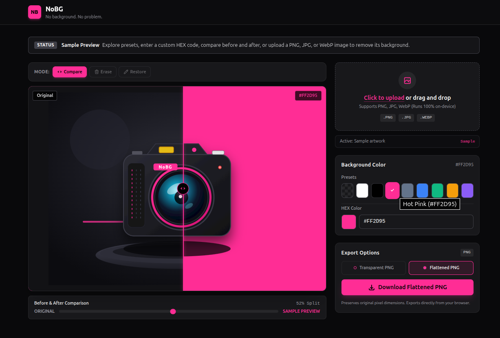

# NoBG

No background. No problem.

Remove a background in your browser, pick any color, and download the result. Your image stays on your device. There is no account, no subscription, and no upload to a server.

**Try it:** [avanith12.github.io/NoBG](https://avanith12.github.io/NoBG/)



## What you can do

1. Drop in a PNG, JPG, or WebP image.
2. Wait while the background comes off. The first image downloads the model, so it takes longer than the next ones.
3. Compare the original and the cutout, then pick a preset or type any `#RRGGBB` color. Changing the color does not run the model again.
4. Erase or restore edges with the brush if the cut needs a fix.
5. Download a transparent PNG, or a PNG filled with the color you picked, at the original size when the browser can do that.

## The AI

NoBG uses [ORMBG](https://huggingface.co/schirrmacher/ormbg), through the [ONNX Community conversion](https://huggingface.co/onnx-community/ormbg-ONNX/tree/034e2d884afbab897e10e78fc5bb566b29533fd6), revision `034e2d884afbab897e10e78fc5bb566b29533fd6`. The model card declares Apache-2.0.

The model runs in the browser with ONNX Runtime Web. It uses WebGPU when the browser has it, and WebAssembly otherwise. The WebGPU weights are about 176 MB. The WebAssembly weights are about 44 MB. The browser caches them when storage allows. The image itself is never sent with those downloads.

## Run it yourself

You need Node.js 22.12 or newer. Node.js 20.19 or newer on the 20 line also works.

```sh
git clone git@github.com:Avanith12/NoBG.git
cd NoBG
npm ci
npm run dev
```

Open the local address Vite prints.

To build the same static site GitHub Pages serves:

```sh
npm run build
npm run preview
```

A push to `main` builds the site and publishes the `dist/` folder to GitHub Pages.

## Good to know

- One image at a time. Export is PNG.
- Fine edges, especially hair, vary by photo. Large images can run out of browser memory.
- Firefox, Safari, and phones were not part of the release check. Chrome on Linux was.
- Batch processing and photo backgrounds are not in this version.
